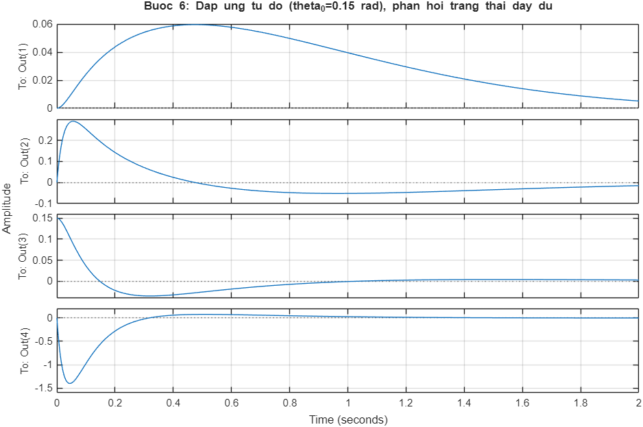

# Two-Wheel Self-Balancing Robot — LQG (LQR + Kalman Observer) on STM32F103

> **Status: Work in progress.** The design scripts and the closed-loop simulation of the C control core run successfully.
> The firmware has **not** been tested on a real robot, and the physical parameters (M, m, l, I, b) are placeholders.

A 2-wheel balancing robot is modeled as an inverted pendulum on a cart, linearized around upright.
It is controlled with an LQG design (LQR state feedback plus a fixed-gain Kalman observer) running every 5 ms on an STM32F103C8T6 "Blue Pill" (STM32CubeIDE/HAL).

Hardware assumed by the firmware: MPU6050 IMU, 2× AS5600 magnetic encoders (one per I2C bus), and 2× stepper motors driven by DRV8825 drivers (STEP/DIR, 1/16 microstepping).

## Design pipeline

| Step | Where | What |
|---|---|---|
| Model | `matlab/xe_can_bang_LQG_vidu.m`, `tools/lqg_design.py` | 4-state model `x = [x, ẋ, θ, θ̇]`, input = horizontal force |
| Analysis | same | controllability rank 4/4. Observability: θ alone gives rank 3/4, while x (encoder) + θ gives 4/4, so both sensors are required |
| LQR | same | Bryson's rule weights (x_max 0.2 m, ẋ_max 0.5 m/s, θ_max 0.1 rad, θ̇_max 1 rad/s, u_max 3 N) |
| Kalman observer | same | steady-state gain from `lqe` with encoder noise 1 mm and IMU angle noise 0.02 rad. Observer poles are about 4.8× faster than controller poles |
| Discretization | same | ZOH at Ts = 5 ms, then `dlqr`/`dlqe`; the resulting `Ad, Bd, Cd, Kd, Ld` are pasted into `Core/Inc/config.h` |

The Python tool (`lqg_design.py`) reproduces the MATLAB pipeline and prints C arrays ready for `config.h`.

## Firmware (Core/)

| Module | Role |
|---|---|
| `mpu6050.c` | I2C driver and a **complementary filter** for tilt angle θ (accel + gyro) |
| `as5600.c` | encoder driver with wrap-around-safe unwrapped angle |
| `estimator.c` | discrete observer `x̂ = Ad x̂ + Bd u + Ld (y − Cd x̂)`. It is fed the **saturated** (actually applied) command, which acts as observer-side anti-windup, and it checks for NaN or blow-up |
| `control.c` | `u = −Kd x̂`, force → wheel acceleration → velocity integration, a separate heading-hold PI loop, left/right wheel allocation `v_L,R = v_cb ∓ v_yaw/2`, and multi-stage saturation and slew limits |
| `stepper_drv8825.c` | converts velocity to STEP frequency using timer PWM |
| `calibration.c` | I2C self-test, gyro bias, IMU mounting-tilt offset, encoder zero |
| `safety.c` | fall cutoff (~26°), tilt-rate and sensor-fault limits, loop-overrun detection, state machine |
| `main.c` | boot flow, peripheral init, 200 Hz TIM2 interrupt, IWDG watchdog |
| `matrix4.c` | small fixed-size matrix helpers |
| `config.h` | **every** constant: LQG matrices, pin map, limits |

## How to run

MATLAB (Control System Toolbox):

```matlab
cd matlab
xe_can_bang_LQG_vidu
```

Python design tool (`pip install numpy scipy control`):

```bash
python tools/lqg_design.py
```

Closed-loop simulation of the C control core (no hardware; the plant is the same discrete model):

```bash
cd tools
gcc -std=c11 -Wall -Wextra -Werror -I../Core/Inc sim_test.c ../Core/Src/matrix4.c ../Core/Src/estimator.c ../Core/Src/control.c -lm -o sim_test
./sim_test
```

For the firmware, create a CubeMX project for STM32F103C8T6 at 72 MHz. Its peripheral and pin settings must match `config.h` §14: I2C1 PB6/PB7, I2C2 PB10/PB11, TIM2 at 200 Hz, TIM3 CH1 PA6 and TIM4 CH3 PB8 for the STEP signals, and IWDG.

## Results

Re-run on 2026-09-26:

- **MATLAB script:** eigenvalues of A are {0, −0.02, +10.89, −10.91}, so the open loop is unstable. `K = [−15.0, −13.8, −60.0, −6.65]`, and `eig(A−BK)` = {−40.0, −9.94, −1.78 ± 1.15i}. Discrete closed loop: `|eig(Ad−Bd·Kd)|` max 0.991; `|eig(Ad−Ld·Cd)|` max 0.949 (both < 1).
- Continuous-time LQR closed loop (full-state feedback) from θ₀ = 0.15 rad, produced by the MATLAB script. Outputs 1–4 are x [m], ẋ [m/s], θ [rad] and θ̇ [rad/s]:

  

- **`sim_test.c`** (GCC 15.2, `-Werror`): starting from θ₀ = 0.15 rad, it reports `PASS: theta settled under 0.01 rad at t=1.385s`. The wheel-speed command hits its ±0.6 m/s limit during the transient.
- **`lqg_design.py`:** syntax check only (the `control` package is not installed on this machine).

## Not done yet

- Measuring the real M, m, l, I, b and regenerating the matrices
- Bring-up on hardware: axis signs, DIR polarity, maximum step rate
- Bluetooth telemetry and a mode button (the pins are reserved but unused)
- A cascade PID alternative for comparison

## About this code

This code was written with an AI assistant at my request. I defined the problem and the requirements.
The verification results above were re-run on my own machine.

## License

MIT. See [LICENSE](LICENSE). This is research and learning code with no warranty; it is not certified for safety-critical use.
